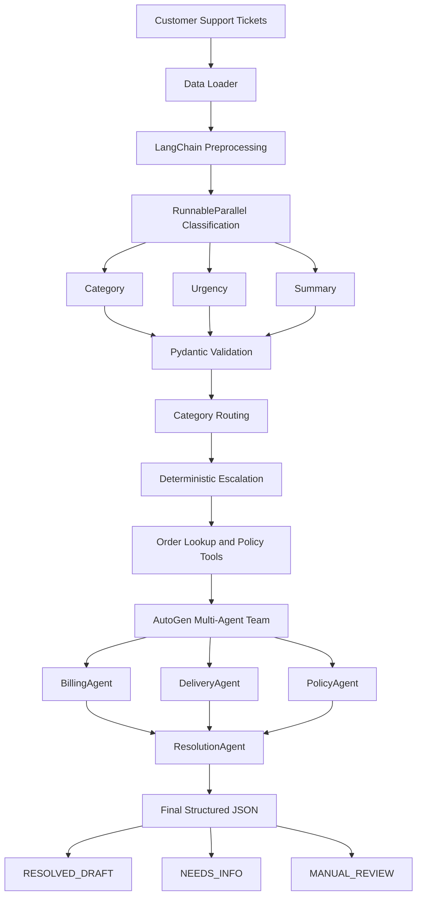

# System Architecture



## Architecture Description

The system accepts customer support tickets from local datasets and processes them through LangChain classification, Pydantic validation, category routing and deterministic escalation rules.

Local support tools provide order and policy information. AutoGen agents investigate the issues and prepare resolution recommendations. The application combines these results into a structured JSON response with an appropriate status.
```
